<picture>
  <source media="(max-width: 600px)" srcset="assets/profile/hero-compact.svg">
  
</picture>

## Product ecosystem

## Technology stack

[Explore public repositories →](https://github.com/whyahmetss?tab=repositories)

## GitHub analytics

Activity reflects [GitHub’s public contribution calendar](https://github.com/whyahmetss?tab=overview). Repository statistics use owned public projects, excluding forks, archived projects, and this profile repo.

---

