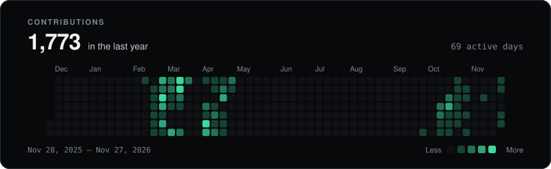
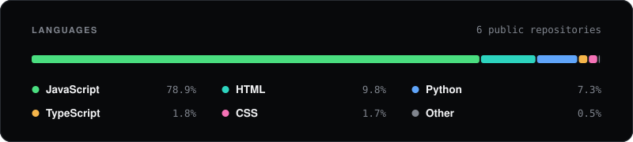

<picture>
  <source media="(max-width: 600px)" srcset="assets/profile/hero-compact.svg">
  
</picture>

  

 

 

 

 

 

Activity from <a href="https://github.com/whyahmetss?tab=overview">GitHub’s public contribution calendar</a>, refreshed daily. Language share covers owned public repositories, excluding forks, archives and this profile repo. · <a href="https://github.com/whyahmetss?tab=repositories">Explore repositories →</a>

  

