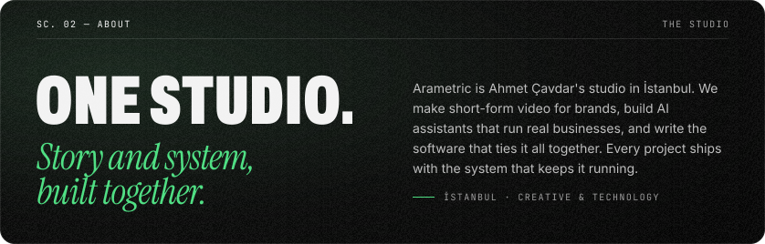
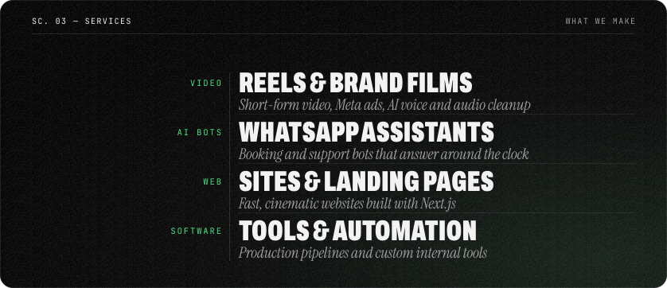
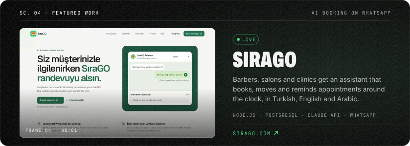
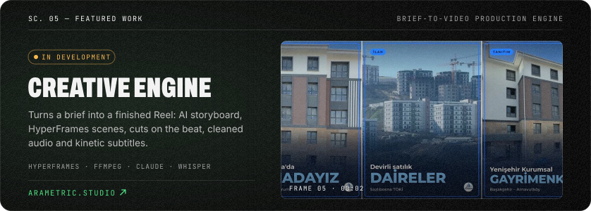
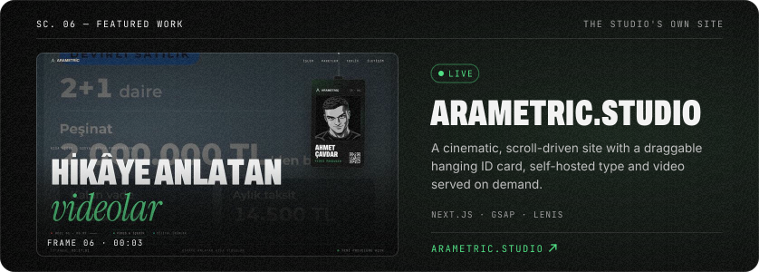
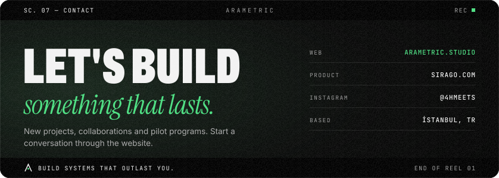

<!-- ARAMETRIC profile. All artwork in assets/profile/ is generated by scripts/profile/build.py; edit text there, not in the SVGs. -->

<a href="https://arametric.studio">
  <picture>
    <source media="(max-width: 600px)" srcset="assets/profile/hero-mobile.svg">
    
  </picture>
</a>

<picture>
  <source media="(max-width: 600px)" srcset="assets/profile/about-mobile.svg">
  
</picture>

<picture>
  <source media="(max-width: 600px)" srcset="assets/profile/services-mobile.svg">
  
</picture>

<a href="https://xn--srago-n4a.com">
  <picture>
    <source media="(max-width: 600px)" srcset="assets/profile/work-sirago-mobile.svg">
    
  </picture>
</a>

<a href="https://arametric.studio/isler/creative-engine">
  <picture>
    <source media="(max-width: 600px)" srcset="assets/profile/work-engine-mobile.svg">
    
  </picture>
</a>

<a href="https://arametric.studio">
  <picture>
    <source media="(max-width: 600px)" srcset="assets/profile/work-site-mobile.svg">
    
  </picture>
</a>

<a href="https://arametric.studio">
  <picture>
    <source media="(max-width: 600px)" srcset="assets/profile/contact-mobile.svg">
    
  </picture>
</a>

<a href="https://arametric.studio">arametric.studio</a> · <a href="https://xn--srago-n4a.com">sırago.com</a> · <a href="https://instagram.com/arametric">Instagram</a> · İstanbul

